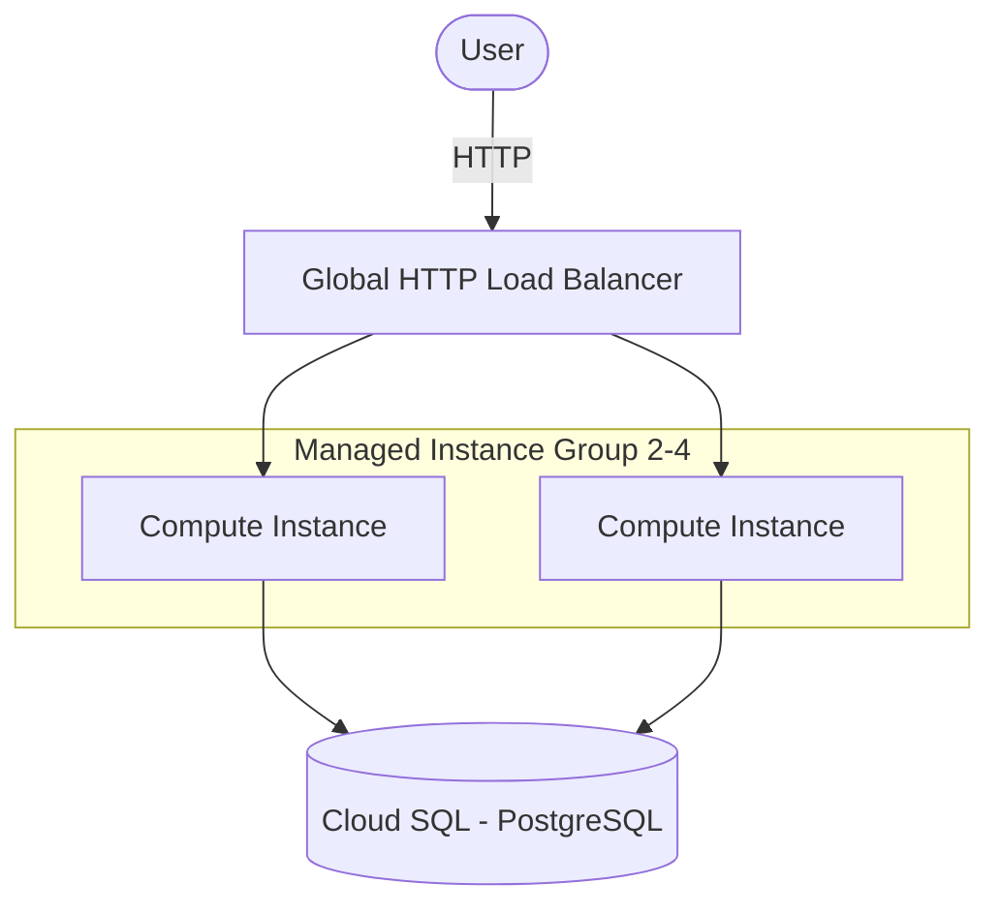

# GCP 3-Tier on Compute Engine (Terraform)

> A classic 3-tier web app on Google Cloud: a Managed Instance Group behind a global HTTP Load Balancer, backed by Cloud SQL — provisioned with Terraform.
> **Author:** Muhammad Ahmad · **IaC:** Terraform · **Cloud:** GCP


---

## 📌 Overview

- **Web tier** — an instance template (Debian + nginx via startup script) driving a **regional Managed Instance Group** with an autoscaler (2–4) and auto-healing.
- **Load balancing** — a **global HTTP Load Balancer** (global IP → proxy → URL map → backend service → MIG) with health checks.
- **Data tier** — **Cloud SQL (PostgreSQL)** with an app database and user.
- Firewall rules allow Google health-check ranges and public HTTP.

## 🏗️ Architecture



## 🚀 Deploy

```bash
cd terraform
gcloud auth application-default login
export TF_VAR_db_password='YourStr0ngPassw0rd'
terraform init
terraform apply -var="project_id=YOUR_PROJECT_ID"

terraform output application_url
```

## 🧹 Clean up

```bash
terraform destroy -var="project_id=YOUR_PROJECT_ID"
```

## 💰 Cost note

Compute instances, the load balancer, and Cloud SQL all bill while running. Uses small `e2-small` / `db-f1-micro`; destroy when done.

## 🔐 Production hardening (next steps)

- Add **HTTPS** with a managed SSL certificate and HTTP→HTTPS redirect.
- Put instances in **private** subnets with Cloud NAT.
- Connect Cloud SQL via **private IP**.

---

*Built and maintained by **Muhammad Ahmad**.*
