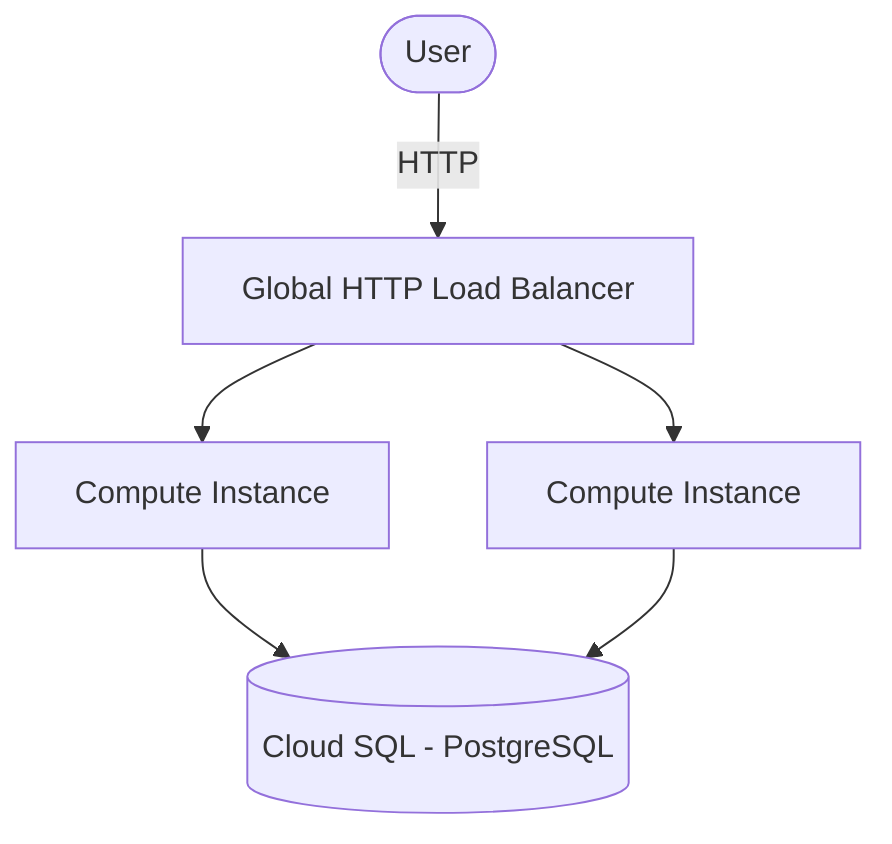

# Architecture Diagram — GCP 3-Tier on Compute Engine

## Lucid diagram

- **View:** https://lucid.app/lucidchart/0580f8a5-809a-446c-b4c3-4a0e2e150c7e/view
- **Edit:** https://lucid.app/lucidchart/0580f8a5-809a-446c-b4c3-4a0e2e150c7e/edit

## Lucid prompt (reusable)

```
Create a GCP architecture diagram titled "GCP 3-Tier on Compute Engine".
A User sends HTTP traffic to a Global HTTP Load Balancer, which distributes to a
Managed Instance Group of 2-4 Compute Engine instances; the instances connect to a
Cloud SQL (PostgreSQL) database. Label the arrows. Clean, professional Google Cloud colors.
```

## Mermaid source


